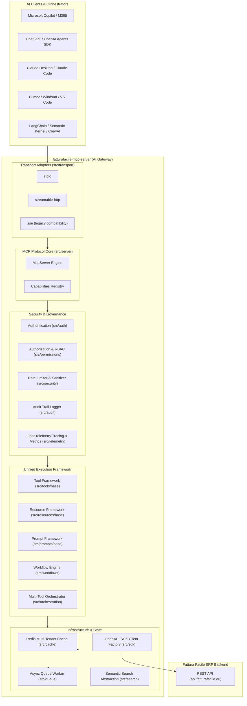
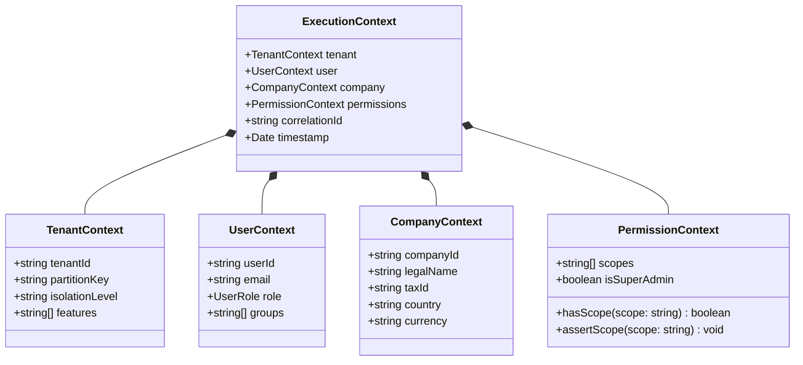
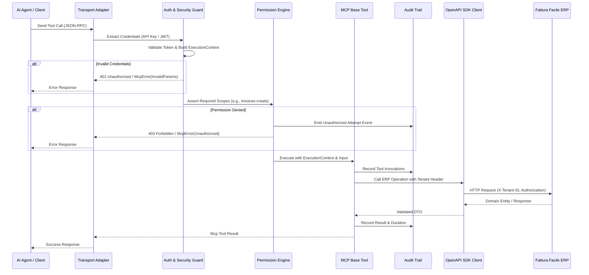

# Enterprise Architecture Specification — fatturafacile-mcp-server

`fatturafacile-mcp-server` is the official Model Context Protocol (MCP) AI Gateway for the Fattura Facile ERP ecosystem. It exposes ERP capabilities through the standard Model Context Protocol, enabling seamless, secure, and auditable interactions for AI agents, assistants, copilots, and autonomous platforms.

---

## 1. High-Level System Architecture

---

## 2. Domain Model & Multi-Tenant Context Hierarchy

In accordance with enterprise multi-tenancy requirements, every execution is strictly scoped:

### Context Isolation Invariants:

1. **Zero Cross-Tenant Leakage:** No query, cache entry, or ERP call can be dispatched without an active `TenantContext`.
2. **Cache Partitioning:** Redis keys strictly follow `tenant:{tenantId}:company:{companyId}:{entity}:{id}`.
3. **Audit Trail Immutability:** Audit records persist tenant, user, company, tool, arguments, duration, and status.

---

## 3. Module Boundaries & Clean Architecture

The codebase strictly adheres to Clean Architecture and SOLID principles:

- `src/bootstrap`: Container lifecycle, process signals (`SIGINT`, `SIGTERM`), graceful teardown.
- `src/config`: Strongly typed environment loading with Zod validation.
- `src/server`: Model Context Protocol server configuration and capability registration.
- `src/transport`: Pluggable transports (`stdio`, `streamable-http`, `sse`).
- `src/auth`: Provider-agnostic token verification (API Key, Bearer JWT, Service Token).
- `src/security`: Rate limiting (Token Bucket), request/response sanitization, security policies.
- `src/permissions`: RBAC evaluation, role-to-scope mappings, company-level data access rules.
- `src/audit`: Structured event logging, audit trail emitters.
- `src/telemetry`: OpenTelemetry tracer, meters, baggage propagation, span lifecycle.
- `src/cache`: Redis cache manager with tenant-scoped keyspaces and in-memory fallback.
- `src/queue`: Background job processing and async workflow runners.
- `src/sdk`: ERP client factory and SDK configuration utilizing `@fatturafacile/openapi-sdk`.
- `src/services`: Core domain services orchestrating SDK operations (Invoices, Customers, etc.).
- `src/workflows`: Deterministic multi-step business workflows.
- `src/orchestration`: Multi-tool planners, execution graphs, compensation & rollback handlers.
- `src/tools`: 39 Domain MCP tools extending the unified base framework.
- `src/resources`: 22 Dynamic MCP resources exposing readable ERP context.
- `src/prompts`: 20 Pre-engineered prompts for LLM workflows.
- `src/schemas`: Shared Zod validation schemas.
- `src/types`: TypeScript contracts, contexts, and helper types.
- `src/validation`: Validation utilities and schema transformers.
- `src/errors`: Standard error classes mapping to MCP protocol error codes.

---

## 4. Security, Authentication & Authorization Sequence

---

## 5. Workflow & Orchestration Model

The workflow engine coordinates multi-step business transactions:

- **Transaction Boundaries:** Logical transaction boundaries spanning multiple ERP actions.
- **Compensation Actions:** If Step 2 fails, Step 1 triggers registered compensation (e.g., canceling draft invoice if payment registration fails).
- **Audit Integration:** Workflows register beginning, checkpoint, and completion events in the audit trail.
