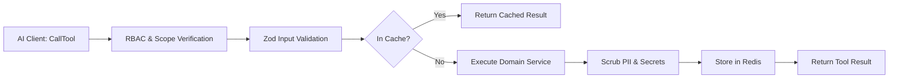

# Model Context Protocol (MCP) Concepts — fatturafacile-mcp-server

The Model Context Protocol (MCP) is an open specification that standardizes how AI models, agents, and copilots access external tools, read contextual data, and consume prompt workflows.

`fatturafacile-mcp-server` natively implements the three core MCP primitives in enterprise-grade TypeScript:

---

## 1. Tools: Action Execution Layer

Tools provide the action-taking capability for AI agents. In `fatturafacile-mcp-server`:

- Every tool extends `BaseTool<TInput, TOutput>`.
- **Validation Pipeline:** Incoming JSON arguments are parsed through strict Zod schemas. Invalid payloads fail before reaching domain logic.
- **Permission Enforcement:** The framework checks `context.permissions.hasScope(requiredScope)` before executing the underlying handler.
- **Observability:** An OpenTelemetry span (`mcp.tool.<name>`) tracks latency and status, while an immutable audit log records the invocation.
- **Resilience:** Unstable network operations automatically retry with exponential backoff (up to 3 attempts).
- **Caching:** Idempotent queries are cached in Redis with tenant keyspacing and automated invalidation.

---

## 2. Resources: Real-Time Context Ingestion

Resources provide dynamic, URI-addressable context to LLMs without requiring interactive tool function calls.

- Every resource extends `BaseResource<TOutput>` and exposes an RFC-compliant URI (e.g., `company://profile`, `invoice://overdue`, `dashboard://summary`).
- Resources support real-time data fetching from the ERP backend with multi-tenant caching and TTL invalidation.
- Clients can inspect available resources via `resources/list` and read them via `resources/read`.

### Available Resource Schemes:

- `company://`: Legal identity, settings, SaaS subscription, and statistics.
- `customer://`: Recent accounts, VIP tiers, inactive debtors, and top accounts.
- `product://`: Real-time catalog, low stock alerts, top sellers.
- `quote://`: Active estimates, draft proposals, expiring quotes.
- `invoice://`: Latest billing, unpaid balances, overdue alerts, and settled invoices.
- `payment://`: Incoming transfers and pending reconciliations.
- `project://`: Active billable projects and client deliverables.
- `dashboard://`: Executive summary, sales velocity, customer health, and cashflow charts.

---

## 3. Prompts: Structured Enterprise Workflows

Prompts are parameterized templates that steer the AI assistant toward standardized, compliant business workflows.

- Every prompt extends `BasePrompt<TArgs>` with Zod schema validation for arguments.
- Prompt responses return structured messages (`system`, `user`, `assistant`) formatted to guide the host LLM.

### Key Prompt Categories:

- **Sales:** Assisting with quote drafting (`CreateQuotePrompt`), invoice generation (`CreateInvoicePrompt`), and dispatching notifications (`SendInvoicePrompt`).
- **Credit Control:** Formulating polite and legally sound dunning notices (`InvoiceReminderPrompt`).
- **Finance & Treasury:** Providing CFO-level liquidity analyses (`CashFlowPrompt`, `FinancialOverviewPrompt`).
- **Executive Productivity:** Summarizing daily operations and generating board-level briefs (`DailySummaryPrompt`, `ExecutiveReportPrompt`).
